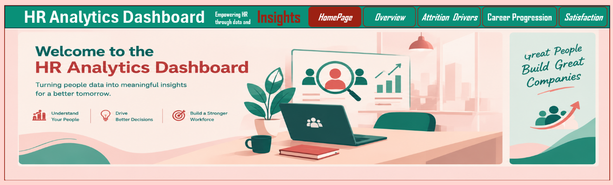

# Employee Attrition Drivers | HR Analytics Dashboard



An end-to-end HR analytics and business intelligence project built in **Microsoft Excel** using **Power Query, Power Pivot, DAX, PivotTables, charts, and interactive dashboard navigation**.

The project explores employee attrition patterns across workforce demographics, overtime, satisfaction, and career progression. It is designed to help HR stakeholders explore where attrition is concentrated and which employee attributes are associated with higher attrition rates.

> **Data source:** IBM HR Analytics (public/sample HR dataset). The workbook is the original macro-enabled project file. The five dashboard screenshots are provided as visual previews.

## Business questions

- What is the overall workforce size and employee attrition rate?
- How does attrition vary by department, job role, age group, marital status, salary range, stock option level, and overtime?
- How are job, environment, and relationship satisfaction distributed across employees?
- How do tenure, time since last promotion, and time in the current role vary among employees who left?
- What do self-ratings and manager ratings show in the latest available performance records?

## Tools and techniques

- **Microsoft Excel** — dashboard delivery and interactive reporting.
- **Power Query** — data preparation and transformation, including a latest-performance-record query.
- **Power Pivot** — relational data model and table relationships.
- **DAX** — workforce, attrition, compensation, tenure, overtime, satisfaction, and performance measures.
- **PivotTables / PivotCharts / Slicers** — interactive analysis and visual exploration.

## Analytical workflow

1. **Source data:** five source tables are identified in the project: `Employee`, `EducationLevel`, `PerformanceRating`, `RatingLevel`, and `SatisfiedLevel`.
2. **Power Query:** prepare the source tables and derive `Latest_PerformanceRating` to retain the latest recorded performance/satisfaction record per employee. Three satisfaction lookup queries are created by duplicating the `SatisfiedLevel` query for job, environment, and relationship satisfaction.
3. **Data model:** load the prepared tables into the Power Pivot model and relate employee and rating/satisfaction attributes to the latest performance records.
4. **DAX:** define measures for headcount, active employees, attrition, salary, age, tenure, overtime, onboarding, satisfaction, and performance ratings.
5. **Reporting:** present the analysis across five dashboard pages: Home, Overview, Attrition Drivers, Career Progression, and Satisfaction.

## Dashboard preview

| Page | Focus |
|---|---|
| Home | Project landing page and navigation |
| Overview | Workforce composition and headline KPIs |
| Attrition Drivers | Attrition patterns by employee and job attributes |
| Career Progression | Tenure, promotion, current role, and ratings |
| Satisfaction | Job, environment, and relationship satisfaction |

See [`Dashboard/Screenshots/`](Dashboard/Screenshots/).

## Selected workbook metrics

The workbook's PivotTables show the following overall figures:

| Metric | Value |
|---|---:|
| Total employees | 1,470 |
| Active employees | 1,233 |
| Employees who left | 237 |
| Overall attrition rate | 16.12% |
| Average monthly salary (overview) | 9,413.04 |
| Average age (overview) | 28.99 |
| Average tenure of active employees (overview) | 4.97 years |

Examples of observed patterns in the workbook:
- Attrition rate is approximately **30.53%** for employees with overtime versus **10.44%** for those without overtime.
- Attrition rate is approximately **23.32%** for single employees.
- The workbook includes a tenure-based onboarding segment (`0–2` years) with an onboarding attrition count of **146**.

These are descriptive patterns in this dataset. They do **not** establish that any factor causes employees to leave.

## Repository structure

```text
Emp-Attrition-Drivers/
├── README.md
├── Excel/
│   └── HR_Analytics_Dashboard.xlsm
├── Dashboard/
│   └── Screenshots/
├── Power_Query/
│   └── Transformation_Logic.md
├── Data_Model/
│   └── Data_Model.md
├── DAX/
│   └── DAX_Measures.md
├── Documentation/
│   ├── Business_Problem.md
│   └── Methodology.md
└── Insights/
    └── Business_Insights.md
```

## How to explore

1. Open `Excel/HR_Analytics_Dashboard.xlsm` in desktop Microsoft Excel.
2. Enable macros only if you trust the workbook and want to use its macro-enabled features.
3. Use the dashboard navigation buttons and available slicers/filters to explore the pages.
4. Review the documentation folders for the data preparation, model, measures, and interpretation notes.

## Important notes and limitations

- The source CSV files were not separately supplied with this repository build. The workbook contains the project and its embedded model; do not treat exported or reconstructed data as original raw files.
- The `Latest_PerformanceRating` table represents the latest **record available in the source data**, not necessarily an employee's real-time current state.
- The measures and visuals should be interpreted with their filter context. A measure filtered to `Attrition = "Yes"` describes employees who left, not the whole workforce.
- The project is descriptive analytics, not a causal model or a validated employee flight-risk prediction system.
- The workbook is macro-enabled (`.xlsm`). Review it before publishing publicly and remove any sensitive or personal information if present.
- Some measure names/definitions are retained as authored. See `DAX/DAX_Measures.md` for validation notes.

## Author

**Abdelrahman Matouk**  
Data Analytics | Excel • Power Query • Power Pivot • DAX

- LinkedIn: https://linkedin.com/in/abdelrahman-ayman-matouk-40ba94352
- GitHub: https://github.com/abdelrahman-matouk
